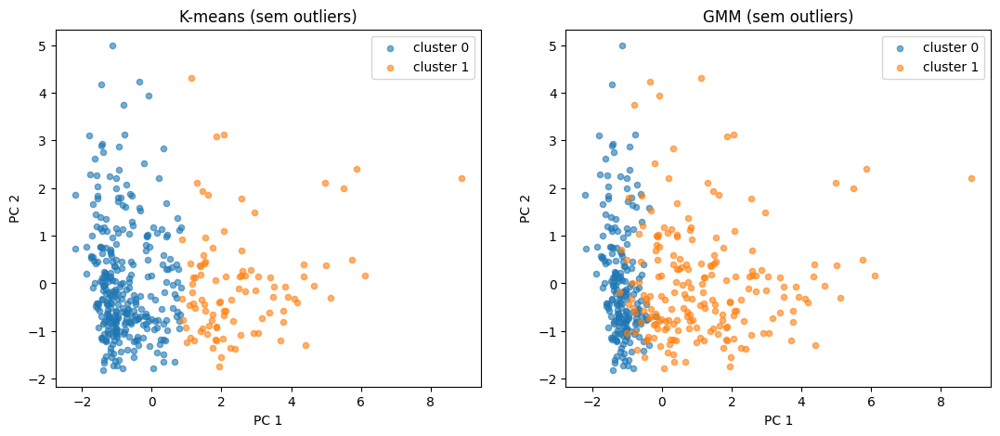

# K-means vs GMM do zero em PyTorch

Comparação entre K-means e Gaussian Mixture Model (via algoritmo EM),
implementados sem sklearn, no dataset Wholesale Customers (UCI).

Continuação: [tsne-do-zero-wholesale](https://github.com/nei-jr/tsne-do-zero-wholesale)



## O que foi feito
- Remoção de outliers por distância de Mahalanobis (corte χ² a 97,5%)
- K-means e GMM implementados manualmente
- Validação com o rótulo real (canal: Horeca vs Varejo)
- Visualização dos clusters via PCA

## Resultados
| Modelo  | Concordância com o canal |
|---------|--------------------------|
| K-means | ~88%                     |
| GMM     | ~79%                     |

O cluster 0 do GMM ficou ~97% puro em Horeca (202 de 208), mas o cluster 1
ficou misturado. O GMM encontra uma estrutura diferente, não necessariamente pior.

## Próximos passos
- Transformação log para reduzir a assimetria
- Avaliação com Adjusted Rand Index (ARI)

## Como rodar
```
pip install pandas torch scipy matplotlib
```

Abra `kmeansvsgmm.ipynb` e execute todas as células.
O arquivo `Wholesale customers data.csv` já está no repositório.

## Dados
[Wholesale Customers – UCI](https://archive.ics.uci.edu/dataset/292/wholesale+customers)
